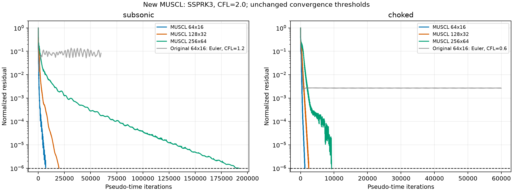
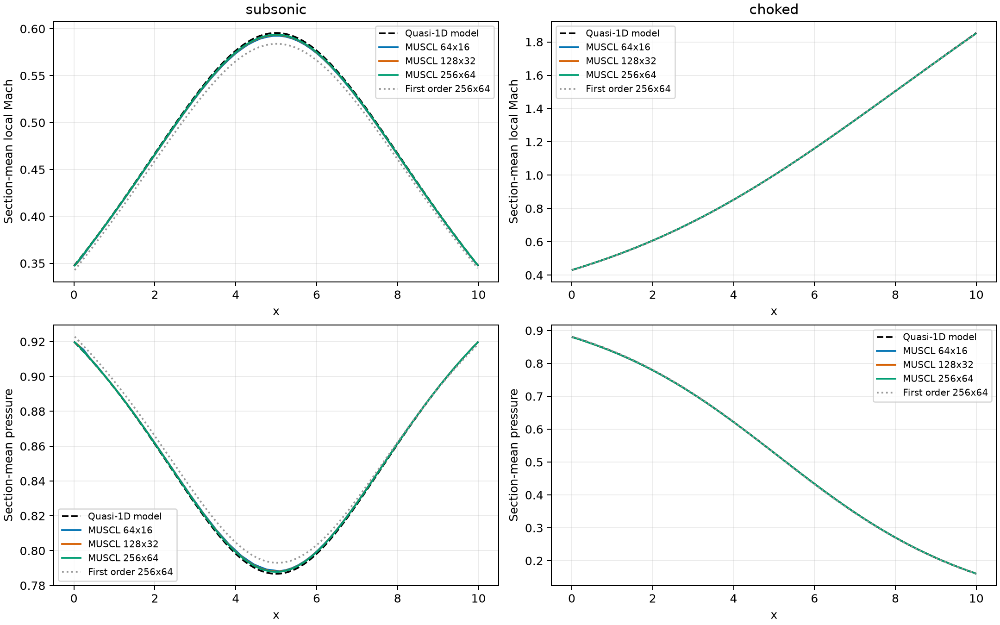
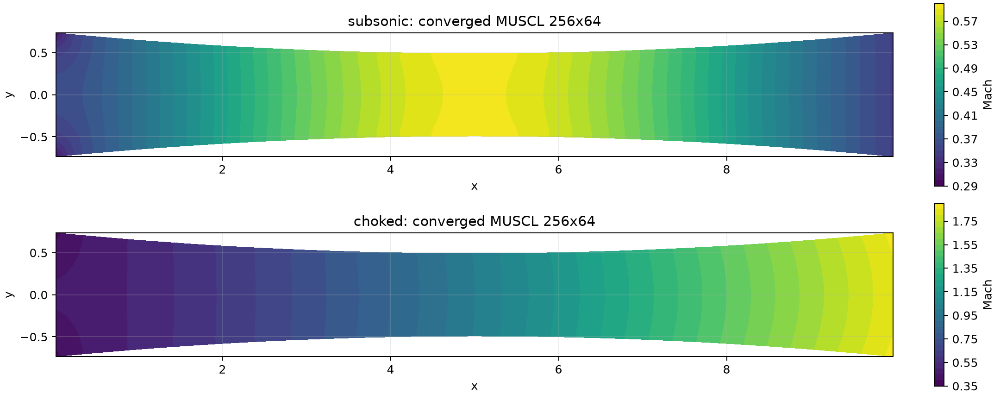
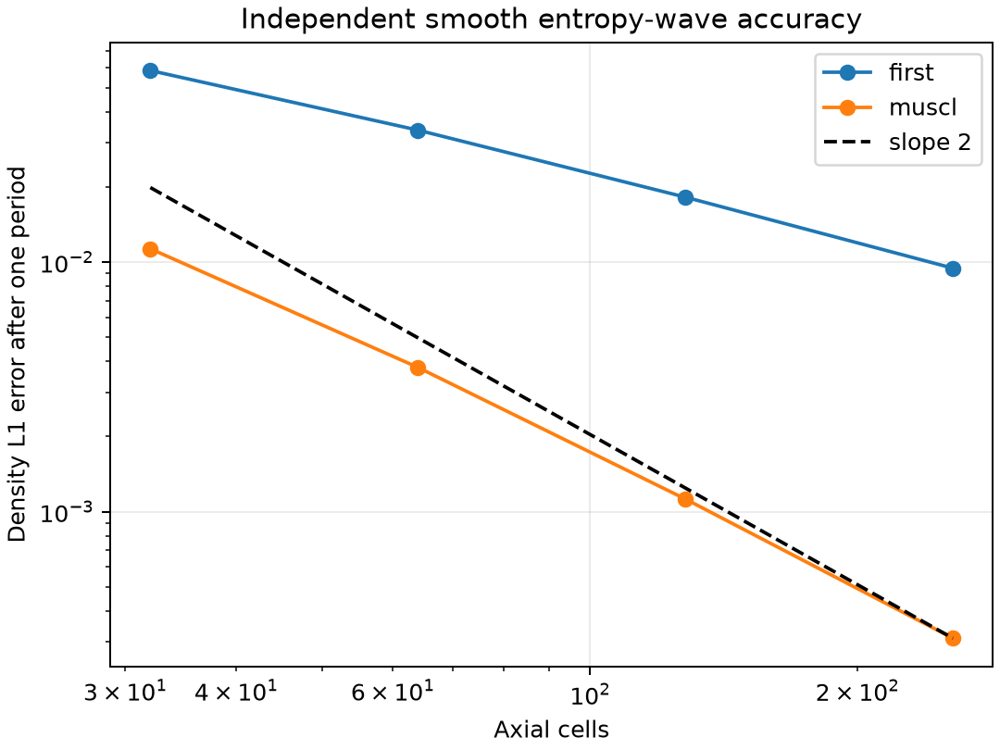

# CPU 显式 MUSCL 诊断、修复和验证（2026-10-26）

本轮 CPU 显式 MUSCL 修复已完成：要求的两工况、三网格共六组全部达到原来的三项收敛判据，修复后的一阶六组也全部通过。以下结论来自重新编译后的实际运行、控制变量实验及独立数值检查；所有失败对照仍保留为失败。

## 原问题的直接证据

读取了任务定义、`GEOMETRY_FIX_REPORT.md`、`M2_M3_REPORT.md`、`M4_M5_REPORT.md`，并从当前源文件重新编译。冻结的旧源码、可执行文件和 SHA256 位于 `output/muscl_repair/legacy/`。没有修改 `CFL3D-master`。

原一阶六组均重新收敛，迭代数为亚声速 14410、25446、43878，壅塞 4109、6883、11259，与面积修复审计一致。它证明了旧程序的迭代状态，但不能单独证明通量公式正确。

在同一个 64×16 亚声速算例上，保持旧重构、minmod、前向 Euler、初始化及判据不变，只替换指定的 Roe 特征向量项：

|版本|CFL|退出|迭代|归一化残差|旧质量诊断|
|---|---:|---|---:|---:|---:|
|原版|1.2|max_iter|60000|8.61197e-2|8.08928e-4|
|原版|0.5|max_iter|60000|1.15274e-2|1.53754e-4|
|原版|0.1|max_iter|60000|6.01867e-3|6.68770e-4|
|只修接触波能量|0.5|converged|32795|9.99793e-7|1.17739e-4|
|只修剪切波能量|0.5|max_iter|60000|1.15147e-2|1.69314e-4|
|两个能量项均修正|0.5|converged|32784|9.99627e-7|1.17074e-4|
|两个能量项均修正|1.2|converged|13642|9.99314e-7|1.17036e-4|

壅塞 64×16、CFL=0.6：原版 60000 次后残差 2.69913e-3；只修两个 Roe 能量项后 3620 次达到 9.99893e-7。CFL=0.1 的“只修 Roe”亚声速运行在 60000 次尚为 1.09249e-4，保留为 `max_iter`，没有将它计入通过。

这些有控制变量的实验把原先残差停滞的主因定位到了 **Roe 接触波能量项**，而不是泛泛归因于“高阶不稳定”。剪切波符号是同时存在、必须修复的公式错误，但单独改它不能消除该停滞。

## 沿数值流程检查到的问题

### 变量重构、方向与限制器

旧版重构守恒变量，并把同一网格行上相邻中心的差分除以 `delta_x` 当成 `dU/dx`。喷管的网格行是弯曲的，相邻中心同时有 `delta_y`，所以这种差分也包含横向变化。

直观地说，沿斜坡走一步，高度和水平位置都变了，不能把全部变化都算成水平方向的变化。新版本先计算物理 `dQ/dy`，再从轴向邻居差值中减去 `dQ/dy * delta_y`，最后除以 `delta_x`，得到 `dQ/dx`。这里 `Q=(rho,u,v,p)`。

旧版 `faceState` 在 `gradient dot (face-centre)` 前又乘了 0.5，而实际中心到面的距离已经是大约半个单元宽。这导致线性场都不能正确恢复，增加了本不该存在的一阶耗散。现在使用完整位移：

```
Q_face = Q_cell + dQ/dx * (x_face-x_cell) + dQ/dy * (y_face-y_cell)
```

minmod 限制器保留：两个相邻斜率方向相反时取零，否则取较小幅度，避免重构制造新的峰谷。它仍可能在局部极值附近降低某个变量、某个方向的精度；这不等于把整个网格切回一阶。边界行/列使用内部单边斜率，不再整条置零。该梯度实现利用了本项目“列上 x 恒定”的网格性质，不是任意非结构网格的通用算法。

### 边界面状态与正性

先把内部状态重构到真实边界面，再在同一位置应用边界关系。墙面反射法向速度，保留切向速度；亚声速入口用总压、总温与内部声学关系，亚声速出口给定静压，超声速出口外推。

采用原始变量重构后，面密度、面压力可以直接检查。若任一面即将违反正性，只缩小该单元全部梯度，系数记作 `theta`；不直接截断状态，不全局切一阶。每个单元的累计触发次数和最终系数都写入 `reconstruction.csv`。阈值低于有效单元平均值，专门测试了接近有效下限的稀薄常量状态。

对旧版亚声速 CFL=0.5 的全程插桩运行，残差文件与未插桩版本逐字节相同：60000 次期间面状态回退 0 次、更新时间步回退 0 次，面密度最低 0.839458、面压力最低 0.782842。因此，原版停滞不是反复触发正性回退的结果。最终状态探针和空间残差分布保存在对应实验目录的 `legacy_probe.txt`、`audit_residual_map.csv`。

### Roe 通量的能量项

令 Roe 平均速度为 `(u,v)`，`K=(u²+v²)/2`，法向 `(nx,ny)`，切向速度 `ut=-u*ny+v*nx`。两个相关的右特征向量应为：

```
接触波: (1, u, v, K)       旧版最后一项错写为 H-K
剪切波: (0, -ny, nx, ut)   旧版最后一项错写为 -ut
```

接触波可以理解为密度变化而压力、速度不变的扰动。给它错误的能量变化，会把原本不该产生的压力扰动引入更新。剪切波的能量变化也必须与切向动量变化保持一致。

直接检验 `rho_L=1,rho_R=1.6,u=0.7,v=0.3,p=1` 的移动接触面，正确 Roe 通量应等于左侧物理通量，旧版能量通量误差为 -0.5201685201；固定密度压力、将右侧 `v` 改为 0.6 的移动剪切面，旧版误差为 +0.0945。修复后的旋转法向接触波、剪切波、全超声速上风通量测试最大误差约 7.1e-15。旧测试只有左右状态相同的情形，跳跃为零，因而完全漏掉了这些错误。

CPU 与 `explicit_backend_common.hpp` 的重复 Roe 公式同时修正；这只是消除同一公式错误，没有进行 GPU/Kokkos 性能扩展或重新计时。一阶空间开关保留并重新验证。

### 残差、质量诊断与退出状态

每个共享面只算一次通量，相邻单元以相反符号汇总，这个守恒结构原来就是正确的。错误的 Roe 耗散项仍以守恒方式分配，所以质量守恒较好不能证明其特征分解正确。

旧 `massAt` 却从单元中心重新计算一阶 Roe 边界通量，既忽略 MUSCL，也忽略用户选择的 Rusanov。它与实际残差用的通量不一致。新版直接积分 `face_flux`；`face_mass.csv` 还输出每一个轴向截面的守恒质量流量。

旧 `max_iter` 路径在写完最后一行残差后仍更新了一次，导致 `field.csv` 比残差记录多一步。新版在最后一次评估后直接退出，场、残差、状态指标对应同一个迭代状态。`max_iter` 仍是失败退出码 2；无效状态为 3；只有三项判据同时通过才是 0。

### 时间推进与 CFL

修复原错误后，旧的半幅重构配 Euler 已可收敛，但恢复完整 MUSCL 重构后，Euler、CFL=0.8 的 64×16 亚声速运行 160000 次仍为 0.133931，且全程没有正性回退。因此它不是完整重构的合适默认推进设置。

新增显式 SSPRK3：每次伪时间迭代包含三个残差评估，使用标准 `1; 3/4+1/4; 1/3+2/3` 组合。局部步长在三个阶段内固定，使用重构面左右状态的最大波速。每个 Euler 子步先验正性，失败时从原始整步状态重新以一半步长试算；回退的正确性有专门回归测试。

本代码的步长定义为 `dt_i=CFL*V_i/sum_faces(max(|un_L|+c_L,|un_R|+c_R)*length)`。CFL 依赖这一定义，不能与采用不同分母的软件直接比较。

SSPRK3 的 CFL=0.8、1.6、2.0 在 64×16 亚声速上分别需要 17790、8894、7115 次，全部通过原判据。128×32、CFL=2.0 为 19772 次。正式配置选 CFL=2.0，并实际覆盖所有要求的网格；这不是任意流场、任意 CFL 的稳定性保证。CFL=0.8 的最细亚声速运行在 160000 次仍为 1.89477e-4，质量不平衡虽已为 1.04081e-6，但残差未过，因此明确保留为 `max_iter`。平滑 van Albada 限制器也做了独立源码变体对照，128×32、CFL=2 需要 21812 次，未优于保留的 minmod；没有以未经验证的限制器替换正式配置。

## 官方 CFL3D 源码对照

直接阅读了本地源码，具体映射见 [CFL3D_MAPPING.md](../CFL3D_MAPPING.md)：

|本地官方位置|本次核实的内容|
|---|---|
|`source/cfl3d/libs/fhat.F:29–32, 203–214`|明确标为 Roe；能量式中的接触波系数等价于 `K`，剪切能量是速度与切向动量增量的点积|
|`source/cfl3d/libs/gfluxr.F:101–160`、`hfluxr.F`|逐 `q` 分量求差并调用 `xlim`，内部和边界插值分开处理|
|`source/cfl3d/libs/xlim.F:113–145, 169–187`|kappa/minmod 面插值及可选密度、压力保护；其半系数针对中心间差值|
|`source/cfl3d/libs/bc1005.F:84–93, 160–179`|构造零法向速度壁面状态、边界标记和梯度数据|
|`source/cfl3d/libs/update.F:106–126`|分别保护密度、压力更新；本项目没有照搬它的隐式修正|
|`source/cfl3d/libs/resid.F`、`dist/mgblk.F`|方向残差、局部步长与更新的调用流程|

也修正了旧映射中的一处描述：官方 `bc1005.F` 在选定路径直接构造壁面面状态，不是本项目这种简单镜像 ghost。项目的反射 Riemann 壁面是简化闭合。官方 `i2d=1` 实际把物理 v 分量置零；本项目二维 `(u,v)` 应按坐标重命名映射到该设置的 `(u,w)`，不是照抄变量下标。固定 `0.1*c` 熵修正、四变量存储、此处的 MUSCL 梯度以及 SSPRK3 都不宣称与某个完整 CFL3D 输入配置逐项一致。

## 六组正式验收及物理对照

沿用原判据，不更改数值：

- `r = sqrt(sum_cells,sum_4_components((R_i/V_i)^2)/N)`，归一化为 `r/max(r_initial,1e-12)`，要求 `<=1e-6`。
- 实际入口/出口守恒通量的相对不平衡 `abs(m_in+m_out)/abs(m_in) <=1e-3`。
- 保留原来的 200 个样本首尾比较：出口流量与平均 `rho/u/p` 相对变化、平均 `v` 对入口声速的变化，最大值 `<=1e-4`。这是原实现的端点窗口检查，不应误称窗口内所有波动的严格上界。

六组均为 `status=converged`、进程退出码 0，使用 CPU serial、Roe、完整原始变量 MUSCL/minmod、SSPRK3、CFL=2.0。`max_iter=400000` 仅作为运行上限；实际均在三项指标通过时退出。分析脚本逐项复核最后残差、状态文件、实际面流量和物理分支。

|工况|网格|迭代|归一化残差|质量不平衡|200 步变化|全截面流量极差/入口流量|
|---|---:|---:|---:|---:|---:|---:|
|亚声速|64×16|7115|9.9496e-07|1.7257e-06|9.5057e-07|1.9866e-06|
|亚声速|128×32|19772|9.9933e-07|2.5760e-07|2.0219e-08|2.6356e-07|
|亚声速|256×64|191781|9.9990e-07|2.6759e-09|9.0280e-09|1.2844e-08|
|壅塞无激波|64×16|1282|9.7664e-07|7.1016e-08|7.6595e-07|7.9457e-08|
|壅塞无激波|128×32|2454|9.8350e-07|2.5326e-08|1.3801e-07|4.5161e-08|
|壅塞无激波|256×64|9272|9.4855e-07|3.9764e-11|9.0410e-09|8.3760e-09|

输出目录为 `output/muscl_repair/muscl_final/`；修复后一阶对照为 `output/muscl_repair/first/`，修复前基线为 `output/muscl_repair/baseline/`。修复后一阶六组迭代数分别为亚声速 14401、25437、43872，壅塞 4098、6863、11216，仍全部满足原判据。

所有正式 MUSCL 运行全程正性保护触发 **0 次**、时间步正性重试 **0 次**；全程最小面密度约 0.211587，最小面压力约 0.114200。最终 **100% 单元都有非零重构增量**，没有全局一阶回退。

最终状态中，minmod 在局部极值附近置零的内部“变量—方向”斜率：亚声速分别为 364/7552（4.82%）、845/31488（2.68%）、1622/128512（1.26%）；壅塞为 286/7552（3.79%）、607/31488（1.93%）、1142/128512（0.89%）。该统计排除仅有浮点噪声的梯度，不包含单边边界方向。这说明局部限制确实存在，也解释了为何不能声称每个点都严格二阶；各单元的其他方向/变量仍在重构。




截面结果采用横向线段长度权重，区分 `mean_local_M` 与 `M_from_mean`。质量流量始终来自面数值通量，不用 `rho*u` 的中心点近似替代。准一维参考使用原始独立 C++ 程序，输出精度提高到 17 位，并以 Python 独立分支求根交叉检查。

|工况|网格|出口流量|与准一维流量相对差|截面平均 Mach 的 L1 差|喉部平均 Mach|末列平均 Mach|
|---|---:|---:|---:|---:|---:|---:|
|亚声速|64×16|0.571865194|0.322%|0.00187761|0.592466|0.350793|
|亚声速|128×32|0.572362721|0.235%|0.00130915|0.593309|0.349033|
|亚声速|256×64|0.572595344|0.195%|0.00105438|0.593677|0.348133|
|壅塞|64×16|0.684550959|0.026%|0.000603961|1.000064|1.838584|
|壅塞|128×32|0.684636621|0.014%|0.000655216|1.000011|1.845361|
|壅塞|256×64|0.684685466|0.007%|0.000672234|1.000001|1.848719|

准一维质量流量为亚声速 0.573712228、壅塞 0.684731456。表内“喉部”由跨越 x=5 的两个列平均值插值得到；“末列”仍位于最后单元中心，不是出口面。亚声速全场保持 M<1；壅塞全部出口面相邻状态的轴向 Mach>1，扩张段持续加速，图中未出现激波压力跳跃。

同网格的完整场与修复后一阶场有可测差异，Mach 最大差值为亚声速 0.0357、0.0193、0.0103；壅塞 0.0104、0.0105、0.0132。这进一步排除了实际使用全局一阶却仅改变配置标签的可能。

壅塞截面平均 Mach 对准一维的 L1 差值随加密为 0.000604、0.000655、0.000672，并非单调趋零。二维横向速度与截面不均匀仍然存在，不能把这组模型差值当成二维空间收敛阶。亚声速 256×64 的该差值由一阶约 0.00806 降为 MUSCL 的 0.00105，属于模型趋势对照。





## 迭代收敛与空间精度的区别

“迭代收敛”意味着给定网格上的离散方程已经基本平衡；“二阶空间精度”意味着把网格宽度减半时，相对于同一个连续问题真解的误差应约减为四分之一。两者必须分别检验。

1. 曲线网格线性场：包括边界单元，面值最大误差 8.88e-16，证明完整重构确实生效。旧版在 64×16 上的同类密度场误差为 3.25744e-3。
2. 曲线网格二次函数：用三角形二次精确积分生成真实单元平均值，在 16×4、32×8、64×16、128×32 上检验面值。加权 L1 误差依次为 1.83972e-3、4.59221e-4、1.14754e-4、2.86852e-5，阶数 2.00223、2.00064、2.00017。这验证重构的二阶性质，不等价于完整喷管边值问题的阶数。
3. 独立周期 Euler 光滑熵波：`rho=1+0.2*sin(2*pi*(x-0.7*t)), u=0.7, v=0, p=1`，以解析单元平均值初始化，运行一个周期。使用实际生产重构/Roe 通量和小全局时间步 SSPRK3，测试夹具只替换周期边界配对。32、64、128、256 单元的 MUSCL 密度 L1 误差为 1.13049e-2、3.78259e-3、1.12270e-3、3.10697e-4，观测阶 1.5795、1.7524、1.8534；一阶对照末级为 0.9453。再将时间步减半，所有网格 L1 误差的最大相对变化仅 4.87e-6，排除了时间离散误差主导这些数值。



因此可以说：线性重构满足曲线网格二阶一致性，独立光滑 Euler 波的 L1 误差呈趋近二阶的趋势。**不声称当前二维喷管全域、各个误差范数都已严格证明二阶**。minmod 在极值附近降斜率、入口与斜壁交点的边界相容性、二维横向流动与准一维模型差异都会影响喷管误差；不能用准一维差值直接拟合二维格式阶数。

## 自动检查、复现与限制

普通 CTest 4/4 通过；包括原几何/块线求解检查、新 Roe 波结构、曲线网格重构、强制局部正性保护、稀薄常量、直通道长期保持、共享面守恒、SSPRK3 整步回退等测试。AddressSanitizer/UndefinedBehaviorSanitizer 4/4 以及完整 32×8 壅塞运行通过。此沙箱内 LeakSanitizer 因 ptrace 限制无法工作，故 sanitizer 运行设置 `ASAN_OPTIONS=detect_leaks=0`；没有宣称验证内存泄漏。

```bash
cd /home/waxeia/A_Waxeia/Softwares/chatgpt/cfl3d_nozzle
cmake -S . -B build-muscl -DCMAKE_BUILD_TYPE=Release \
  -DNOZZLE_ENABLE_OPENMP=OFF -DNOZZLE_ENABLE_CUDA=OFF -DNOZZLE_ENABLE_KOKKOS=OFF
cmake --build build-muscl -j2
ctest --test-dir build-muscl --output-on-failure

# 冻结旧源码的六组一阶，以及 Roe 逐项实验
python3 scripts/reproduce_muscl_legacy.py baseline
python3 scripts/reproduce_muscl_legacy.py ablation
g++ -O3 -std=c++17 tests/legacy_muscl_probe.cpp -o output/muscl_repair/legacy/legacy_probe
output/muscl_repair/legacy/legacy_probe \
  output/muscl_repair/experiments/original_subsonic_64_cfl0.5/input.cfg \
  output/muscl_repair/experiments/original_subsonic_64_cfl0.5

# 先小网格，再正式六组与保留的一阶对照
python3 scripts/validate_muscl.py small --cfl 2 --output-group small_cfl2
python3 scripts/validate_muscl.py muscl --cfl 2 --output-group muscl_final
python3 scripts/validate_muscl.py first
./build-muscl/muscl_numerics_test --accuracy-study output/muscl_repair/accuracy
./build-muscl/muscl_numerics_test --accuracy-half-dt output/muscl_repair/accuracy_half_dt
python3 scripts/analyze_muscl.py --no-plots
# 需要 matplotlib；无图汇总仅用 Python 标准库
python3 scripts/analyze_muscl.py
```

每次正式运行的 `config.cfg` 可直接作为输入复跑，第二个命令行参数可指定新的输出目录。`input.cfg`、`stdout.log`、`process_exit_code.txt` 由批量脚本保留；`build_info.txt` 保存编译器和求解器源文件 SHA256。六组正式运行前曾修正近 `1e-10` 有效下限处的保护阈值；早期 CFL=0.8/一阶对照的源码快照单独保存，保护没有触发的算例不受该边缘修正影响。

最细亚声速收敛仍明显偏慢：191781 次，当前这次带完整诊断的串行运行约 1294 秒。这里只给出本次耗时，不作为性能基准或加速结论；未用 AF、多重网格或并行优化缩短它。一阶 AF 原配置另做了保留功能回归，4932 次收敛，但没有扩展或重新认证其隐式模型。

本轮范围是 CPU 显式光滑无激波喷管。不扩展隐式 AF，不验证 CUDA/Kokkos 新性能，不保证强激波、接近真空、反向流或任意曲线网格的鲁棒性。Roe 不是无条件正性保持通量；当前保护与重试是可追踪的工程措施。正式状态是否通过必须以完整数值记录为准。

审计包的代码、配置、正式结果与图表校验和见 `output/muscl_repair/manifest.sha256`；可在项目根目录执行 `sha256sum -c output/muscl_repair/manifest.sha256`。
